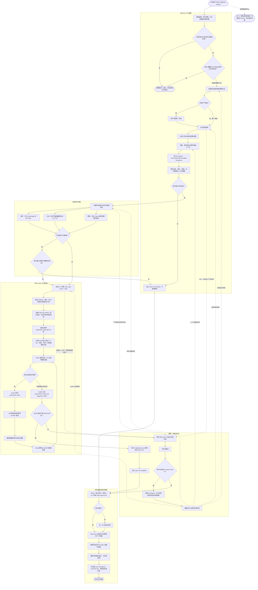

# Feishu Chat Diagnose CLI

手动选择飞书群聊或私聊，拉取限定时间范围内的消息与多模态附件，再让 Codex 在明确指定的本地仓库中进行只读问题诊断。

## 安装

```bash
# 在项目目录执行一次安装，使用 uv.lock 中已验证的依赖版本。
diagnose_constraints="$(mktemp)"
uv export --locked --no-dev --no-emit-project --no-hashes --output-file "$diagnose_constraints"
uv tool install --python 3.12 --constraints "$diagnose_constraints" .
# 若安装时提示命令目录不在 PATH 中，执行后重新打开终端。
uv tool update-shell

# 首次升级时在旧项目目录执行，以自动迁移配置；之后可在任意目录使用。
feishu-diagnose init
```

在 `~/.feishu-diagnose/config.toml` 中配置允许诊断的仓库绝对路径、默认诊断 Skill、可覆盖的 Skill 白名单与视频模型。Skill 必须位于目标仓库的 `.agents/skills/<name>/SKILL.md`：

```toml
[repositories.demo-project]
path = "/absolute/path/to/demo-project"
description = "Demo project"
diagnosis_skill = "project-bugfix"
allowed_skills = ["project-bugfix", "performance-optimization"]
```

仓库只能通过别名选择，聊天内容不能改变仓库、Skill 或权限。`diagnosis_skill` 可以留空；设置后将作为该仓库的默认诊断流程。

### 全局配置与初始化

唯一配置模板位于 [`src/feishu_chat_diagnose/config.example.toml`](src/feishu_chat_diagnose/config.example.toml)，随安装包分发；通过 `feishu-diagnose init` 生成实际配置。

```text
~/.feishu-diagnose/
├── config.toml
└── cases/
    └── <case-id>/
```

`init` 生成带注释的配置模板和案例目录，不调用外部服务；重复执行会保留已有全局配置。如果当前目录存在旧的 `config/config.toml` 且全局配置尚不存在，会自动迁移配置：保留注释及模型、Skill 等设置，将相对仓库和可执行文件路径按当前项目目录转换为绝对路径，并将 `case_dir` 改为 `cases`。原配置保留，旧案例不迁移。旧配置无效时会报错，不会用模板替代。

因此，从旧版本升级时，应先在旧项目目录运行一次 `feishu-diagnose init`，之后即可在任意目录使用。若之前已设置 `FEISHU_DIAGNOSE_CONFIG`，迁移后请取消该变量或指向新配置，否则普通命令仍会使用旧配置。

配置优先级为：各子命令的 `--config` → `FEISHU_DIAGNOSE_CONFIG` → `~/.feishu-diagnose/config.toml`。普通命令不再自动读取当前目录的配置；`init` 始终初始化全局位置。缺少配置时会提示初始化。

```bash
feishu-diagnose list --config /absolute/path/to/other-config.toml
```

配置文件路径支持 `~`，相对路径按调用目录解析；配置内的仓库和案例相对路径按配置文件所在目录解析。未设置 `case_dir` 时始终使用全局案例目录。普通可执行命令名通过 `PATH` 查找，可执行文件路径按配置目录解析。显式使用旧配置时，也适用新的相对路径规则；请先将旧相对路径改为绝对路径。

`uv tool install` 默认不读取项目的 `uv.lock`；上述导出约束的步骤让安装与测试使用相同的依赖版本，避免重新解析出需要额外编译环境的新版本。临时约束文件无需保留到项目中。

源码或依赖更新后，重新导出约束并执行安装命令，添加 `--reinstall`。开发时在安装命令中增加 `--editable`，源码修改直接生效，依赖或入口变更仍需重新安装。仓库内开发与测试继续使用 `uv sync --python 3.12 --extra dev` 和 `uv run pytest`，也可运行 `uv run feishu-diagnose ...`。

飞书访问使用当前用户身份，需要先完成 `lark-cli` 登录，并授权以下只读 scope：

```text
im:message:readonly im:chat:read
im:message.group_msg:get_as_user im:message.p2p_msg:get_as_user
contact:user.base:readonly
```

视频理解需要在环境中设置 `GEMINI_API_KEY`，不要将值写入配置或提交到 Git。

## 使用

```bash
export GEMINI_API_KEY="你的 Gemini API Key"
GEMINI_API_KEY="你的 Key" \
feishu-diagnose doctor
feishu-diagnose analyze --group "示例群" --repo demo-project --since 2h
feishu-diagnose analyze --group "示例群" --repo demo-project --skill project-bugfix --since 2h
feishu-diagnose analyze --group "研发示例群" --repo demo-project --since 2h
feishu-diagnose analyze --person "张三" --repo demo-project --start "2026-07-15 16:00" --end "2026-07-15 17:00"
feishu-diagnose analyze --person "张三" --repo demo-project --skill project-bugfix --since 2h
feishu-diagnose list
feishu-diagnose show <case-id>
feishu-diagnose resume <case-id>
```

`analyze` 会先显示消息、图片、视频和文件数量，默认不继续；附件下载不完整时还会进行第二次确认。模型输出不符合 Schema、Codex 失败或视频工具失败时都不会自动重试，只有显式执行 `resume` 才会再次启动诊断。

没有传 `--skill` 时使用仓库的 `diagnosis_skill`；传入时只能选择 `allowed_skills` 中的 Skill。CLI 会先校验本地文件，再通过 app-server `skills/list` 确认 Codex 已发现并启用它，最后以原生 Skill 输入显式激活。实际使用的 Skill 会写入 `diagnosis.json`、`report.md` 和执行日志。

确认后，终端会持续输出会话、附件、Skill 选择、Codex 初始化、工具步骤和报告保存进度。Codex 暂无新事件时每 10 秒输出一次等待心跳。相同事件会写入 case 的 `execution.log`：

```bash
tail -f ~/.feishu-diagnose/cases/<case-id>/execution.log
feishu-diagnose show <case-id>
```

执行日志不包含聊天正文、附件内容、附件 key、临时文件路径、密钥、原始命令参数或模型完整响应。

## 完整流程



## 数据与边界

case 默认保存在 `~/.feishu-diagnose/cases/<case-id>/`，其中可能包含私聊正文，请勿提交或公开分享。图片、视频和普通附件只存在于运行期临时目录，结束后删除。Gemini 仅作为 Codex 可调用的原始视频理解工具，最终问题归因和仓库分析只由同一个 Codex turn 完成。

首版不提供机器人、消息监听、飞书回复、代码修改、提交或推送，也没有自动重试。

## 手工冒烟测试

准备一个测试群，发送一段问题文本、一张截图和一个 MP4；将对应测试仓库加入配置。先运行 `doctor`，再用较短的 `--since` 执行 `analyze`。确认报告包含聊天事实、视频时间点和仓库代码证据，并检查 case 目录中没有残留图片或视频。
