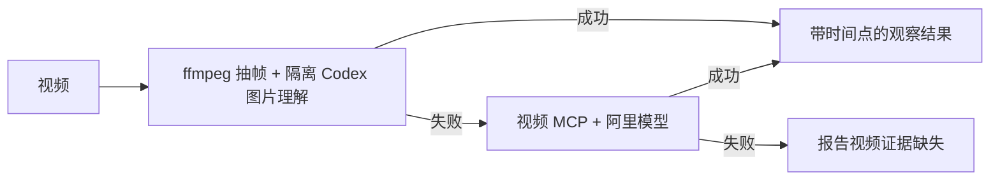
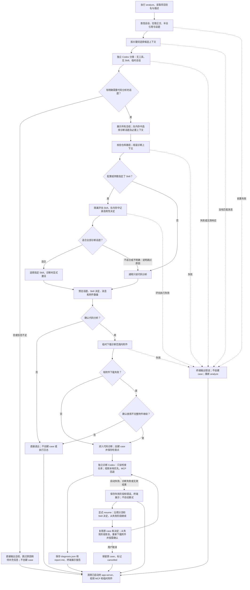

# Feishu Chat Diagnose CLI

手动选择飞书群聊或私聊，先根据聊天正文判断讨论类型及是否需要代码分析。无需代码时直接输出总结和原因；需要时，再让 Codex 在指定的本地仓库中进行只读分析。

## 安装

```bash
# 在项目目录执行一次安装，使用 uv.lock 中已验证的依赖版本。
diagnose_constraints="$(mktemp)"
uv export --locked --no-dev --no-emit-project --no-hashes --output-file "$diagnose_constraints"
uv tool install --python 3.12 --constraints "$diagnose_constraints" .
# 若安装时提示命令目录不在 PATH 中，执行后重新打开终端。
uv tool update-shell

# 首次升级时在旧项目目录执行，以自动迁移配置；之后可在任意目录使用。
feishu-diagnose init
```

在 `~/.feishu-diagnose/config.toml` 中配置允许诊断的仓库绝对路径、默认诊断 Skill、可覆盖的 Skill 白名单与视频模型。Skill 必须位于目标仓库的 `.agents/skills/<name>/SKILL.md`：

```toml
[repositories.demo-project]
path = "/absolute/path/to/demo-project"
description = "文档编辑器，负责富文本编辑、文档导入与导出"
diagnosis_skill = "project-bugfix"
allowed_skills = ["project-bugfix", "performance-optimization"]
```

仓库只能通过别名选择，聊天内容不能改变仓库、Skill 或权限。Skill 路径中的符号链接解析后仍须位于该仓库内，且 Skill 文件不得越出解析后的 skills 目录。`description` 用于前置判断，请说明项目职责和业务范围；判断时不会读取 README 或源代码。`diagnosis_skill` 可以留空；设置后会先评估是否适合当前代码分析话题。

### 全局配置与初始化

唯一配置模板位于 [`src/feishu_chat_diagnose/config.example.toml`](src/feishu_chat_diagnose/config.example.toml)，随安装包分发；通过 `feishu-diagnose init` 生成实际配置。

```text
~/.feishu-diagnose/
├── config.toml
└── cases/             # init 可创建的空根目录
    └── <case-id>/     # 仅进入代码诊断阶段后创建
```

`init` 生成带注释的配置模板和案例目录，不调用外部服务；重复执行会保留已有全局配置。如果当前目录存在旧的 `config/config.toml` 且全局配置尚不存在，会自动迁移配置：保留注释及模型、Skill 等设置，将相对仓库和可执行文件路径按当前项目目录转换为绝对路径，并将 `case_dir` 改为 `cases`。原配置保留，旧案例不迁移。旧配置无效时会报错，不会用模板替代。

因此，从旧版本升级时，应先在旧项目目录运行一次 `feishu-diagnose init`，之后即可在任意目录使用。若之前已设置 `FEISHU_DIAGNOSE_CONFIG`，迁移后请取消该变量或指向新配置，否则普通命令仍会使用旧配置。

配置优先级为：各子命令的 `--config` → `FEISHU_DIAGNOSE_CONFIG` → `~/.feishu-diagnose/config.toml`。普通命令不再自动读取当前目录的配置；`init` 始终初始化全局位置。缺少配置时会提示初始化。

```bash
feishu-diagnose list --config /absolute/path/to/other-config.toml
```

配置文件路径支持 `~`，相对路径按调用目录解析；配置内的仓库和案例相对路径按配置文件所在目录解析。未设置 `case_dir` 时始终使用全局案例目录。普通可执行命令名通过 `PATH` 查找，可执行文件路径按配置目录解析。显式使用旧配置时，也适用新的相对路径规则；请先将旧相对路径改为绝对路径。

`uv tool install` 默认不读取项目的 `uv.lock`；上述导出约束的步骤让安装与测试使用相同的依赖版本，避免重新解析出需要额外编译环境的新版本。临时约束文件无需保留到项目中。

普通安装会保存源码副本，仓库中的修改不会自动更新全局 `feishu-diagnose`。源码或依赖更新后，在项目根目录重新安装：

```bash
diagnose_constraints="$(mktemp)"
uv export --locked --no-dev --no-emit-project --no-hashes --output-file "$diagnose_constraints"
uv tool install --python 3.12 --constraints "$diagnose_constraints" --reinstall .
```

开发时在安装命令中增加 `--editable`，源码修改直接生效，依赖或入口变更仍需重新安装。仓库内开发与测试继续使用 `uv sync --python 3.12 --extra dev` 和 `uv run pytest`，也可运行 `uv run feishu-diagnose ...` 使用当前源码。

飞书访问使用当前用户身份，需要先完成 `lark-cli` 登录，并授权以下只读 scope：

```text
im:message:readonly im:chat:read
im:message.group_msg:get_as_user im:message.p2p_msg:get_as_user
contact:user.base:readonly
```

视频默认使用本地 `ffmpeg`/`ffprobe` 抽帧，再交给配置的 Codex 模型理解图片；本地指解码在本机执行，图片仍发送给 Codex。请先安装这两个工具（macOS 可用 `brew install ffmpeg`）。本地失败后才使用视频 MCP 与阿里模型 `qwen3-vl-plus`；需要回退能力时，在 `~/.feishu-diagnose/config.toml` 中配置：

```toml
[video_tool]
provider = "dashscope"
model = "qwen3-vl-plus"
base_url = "https://你的业务空间和地域地址/compatible-mode/v1"
api_key = "对应服务的 API Key"
timeout_seconds = 300
```

Base URL 请从百炼控制台或网关提供方获取，不能混用 Coding Plan 地址和 Key。模型必须在所用服务开放。旧 Gemini 配置需修改 provider、model、base_url 并更换 API Key；不会自动沿用 Gemini Key。

也可设置环境变量 `DASHSCOPE_API_KEY`；非空环境变量优先于配置中的 `api_key`。已有配置不会被 `init` 覆盖，请直接补充以上字段。Key 通过子进程环境传给专属视频 MCP，并用于向 base_url 发送 API 请求，不放入命令行参数或诊断提示；执行日志与失败记录会脱敏。请将全局配置权限设为仅本人可读写（`chmod 600 ~/.feishu-diagnose/config.toml`），不要提交含 Key 的配置。

## 使用

```bash
feishu-diagnose doctor
feishu-diagnose video-check /path/to/test.mp4
feishu-diagnose analyze --group "示例群" --repo demo-project --since 2h
feishu-diagnose analyze --group "示例群" --repo demo-project --skill project-bugfix --since 2h
feishu-diagnose analyze --group "示例群" --repo demo-project --keyword "导出" --since 2h
feishu-diagnose analyze --person "张三" --repo demo-project --start "2026-07-15 16:00" --end "2026-07-15 17:00"
feishu-diagnose analyze --person "张三" --repo demo-project --skill project-bugfix --since 2h
feishu-diagnose list
feishu-diagnose show <case-id>
feishu-diagnose resume <case-id>
```

### 独立验证视频工具

`video-check` 独立验证视频理解，不调用飞书、不读取项目或 Skill、不创建 case。

```bash
feishu-diagnose video-check /path/to/test.mp4                   # 本地优先，失败回退 MCP
feishu-diagnose video-check /path/to/test.mp4 --backend local   # 只验证无 MCP 路径
feishu-diagnose video-check /path/to/test.mp4 --backend mcp     # 只验证现有视频 MCP
feishu-diagnose video-check /path/to/test.mp4 --json
```



| 方式 | 配置与边界 |
| --- | --- |
| 本地（默认优先） | 使用 `[codex]` 与 `[video_local]`；无需 MCP Key。约每秒一帧，长视频均匀采样，默认最多 24 帧、最长边 1280 像素、图片合计 16 MiB；解码限时 30 秒，抽帧与理解合计 120 秒 |
| MCP（失败后回退） | 使用 `[video_tool]`，默认请求上限 300 秒；初始化与工具发现上限 30 秒，同时受当前诊断剩余时间约束。Base64 须小于 10 MB（原视频约小于 7.5 MB） |

支持 MP4、M4V、MOV、AVI、MKV、FLV、WMV 和 WebM。缺少本地依赖、解码失败、超时、响应无效或模型明确无法读取画面时回退；没发现 bug 或业务信息不足不触发回退。取消、路径越界和诊断总时限到期不触发回退。同一诊断内同一视频的成功或失败结果会缓存，避免重复调用；`resume` 使用新的缓存。两种方式均不理解音轨，抽样观察不代表检查了全部视频帧。

原视频保持不变，临时视频副本和帧图片在成功、失败、取消后清理。诊断仓库继续只读，抽帧由 CLI 在专用临时目录执行。`auto`/`local` 仅加载 Codex 和视频配置，不校验仓库；`--backend mcp` 仍无需 Codex，仅校验 MCP 配置。本地成功时不启动备用视频 MCP，也不检查其凭据。

进度和错误写入 stderr，结果写入 stdout。`--json` 输出摘要、时间点观察及缺失信息；`auto`/`local` 还包含 `backend` 和 `fallback_reason`。自检来源 ID 固定为 `video-check`。参数错误、执行失败、中断、成功的退出码分别为 `2`、`1`、`130`、`0`。不保存原始模型响应。

| 命令 | 验证范围 |
| --- | --- |
| `doctor` | 配置、飞书授权、Codex 初始化，以及本地依赖和备用 MCP 凭据；不实际调用视频模型 |
| `video-check` | 按指定方式验证视频理解与结果结构；默认验证本地优先和 MCP 回退 |
| 含视频的 `analyze` | 飞书下载、统一客户端视频工具、视频观察与仓库诊断 |

自检成功表示执行完成且结果结构有效；请对照内容已知的录屏检查观察是否准确。

### 诊断与恢复

`analyze` 查找会话并拉取消息后，自动调用一个独立、临时的 Codex 分类会话，仅提供项目别名、配置中的 `description`、聊天正文及引用/话题关系。该会话不读取仓库、附件或 Skill，没有命令、搜索和 MCP 等工具。分类、Skill 适用性评估和后续代码诊断使用独立会话，共用 `[codex]` 的模型、授权与超时配置。前置分类与 Skill 评估发生在诊断确认之前，会调用 Codex 模型。

分类将聊天分为问题反馈、需求讨论、设计讨论、其他讨论和信息不足。只有明确关联项目且需要检查现有实现的话题才进入代码分析；需求和设计讨论也可以进入，不会强行套用 bug 归因。无关、无需代码或信息不足时，终端直接输出中文总结、跳过原因及待补充信息，不创建 case，不调用后续 Skill，不下载附件。此时不会校验本地仓库路径或 Skill 文件。

混合话题会在终端展示全部总结，仅选择需要代码分析的话题及必要根消息、引用祖先，不会仅因处于同一线程就纳入其他回复。诊断输入会区分分析目标和仅供参考的背景消息。随后校验仓库、评估指定 Skill，并预览分析话题、Skill 决定以及消息和附件数量。用户确认后才下载附件；附件下载不完整时还会进行第二次确认。以上步骤均只使用内存和临时附件，不创建 case 或执行日志。仅在全部确认完成、实际进入代码诊断阶段时，才创建 case 并保存选定上下文和分流决定。

首次执行 `analyze` 时，各种结果的处理如下：

| 结果 | 退出码 | case 与执行日志 | 下一步 |
| --- | --- | --- | --- |
| 无消息，或会话查找、拉取、分类、校验、组装、Skill 评估失败，或附件准备异常中止 | `1` | 不创建，仅在终端输出错误 | 修正条件后重新执行 `analyze` |
| 无需代码分析或信息不足 | `0` | 不创建，直接展示总结和原因 | 按提示补充背景或结束 |
| 取消诊断确认或附件不完整确认 | `0` | 不创建，显示“已取消代码诊断；未创建 case。” | 需要时重新执行 `analyze` |
| 代码诊断完成 | `0` | 保存检查点、日志和报告，终端展示 `report.md` | 使用 `show` 查看案例 |
| 进入代码诊断后失败，含 Codex 启动失败 | `1` | 保存失败阶段、错误、检查点和日志 | 显式执行 `resume <case-id>` |

无消息时会输出 `Error: No messages found in the selected time range`。未指定时间范围时，默认取 `defaults.message_window`（模板为 `2h`）；可扩大 `--since` 或指定 `--start/--end` 后重试。这里“不创建 case”指不新增 `<case-id>/` 及其中的文件；`init` 已创建的空 `cases/` 根目录可以存在。

分类格式无效、隔离配置无法落实或分类意外请求工具时，会停止，不自动进入代码诊断。分类隔离已用 Codex 0.164.0 本地验证；旧版本不支持所需选项时请升级。`doctor` 仅检查配置、授权、凭据和 app-server 初始化，不验证分类隔离或实际模型响应。所有阶段均不自动重试。

无需代码时的输出示例：

```text
聊天内容总结：

1. 需求讨论：讨论下季度需求优先级和排期
未进行代码诊断：当前仅讨论业务优先级，无需检查项目现有实现

未进行代码诊断；未创建 case。
```

消息拉取会交替补全引用父消息和关联话题，直到没有尚未尝试的关联；话题新增消息的引用也会继续补全，因此上下文可能超出所选时间范围。同一次拉取中，每个引用目标和话题只补全一次（话题接口会分页），失败项会显示在缺失提示中。

合并转发的会话记录（含嵌套转发）会保留展开后的正文，并识别其中的图片、视频和文件附件；用户确认后才下载。视频通过本地优先、MCP 回退的统一工具理解，UTF-8 文本文件（如 `.txt`、`.log`、`.json`、`.md`）读取正文；其他文件保留附件记录，不提取正文。

`--keyword` 按消息正文筛选，并保留关联引用链和话题。`defaults.max_messages` 限制最终组装的消息数；超限会报错，不会截断上下文。

前置分类有独立的输入预算：`defaults.max_triage_messages` 默认 1000 条候选消息，`defaults.max_triage_text_bytes` 默认 262144 字节（聊天正文、项目别名及描述合计的 UTF-8 大小）。按关键词和关联上下文组装后检查；超限时会在调用分类模型前停止，提示缩短时间窗口或使用关键词缩小范围，不截断聊天、不创建 case。两个预算均须为正整数，与最终诊断消息数限制分别生效。

`resume` 只支持失败案例，从记录的失败阶段继续；新 case 的首次失败阶段从代码诊断（含 Codex 启动）开始，前置失败和取消均没有 case。旧版本留下的会话查找、消息拉取、组装、确认或附件阶段案例仍可恢复；已完成或已取消的旧案例需重新执行 `analyze`。恢复到附件准备或诊断阶段时会重新下载附件，下载不完整须再次确认，可继续使用可用附件或取消；临时文件在完成、失败或取消后清理。进入代码分析流程的 `analyze` 和 `resume` 完成后会在终端输出 case ID 和状态；成功时直接展示该 case 的 `report.md` 全文，失败时向标准错误输出失败阶段和错误信息。以 `stage: failed` 结束时返回退出码 `1`，正常完成或用户取消时返回 `0`；报告读取失败时提示文件路径并返回 `1`。

新 case 的 `triage.json` 保存需要代码分析的话题、指定 Skill 和适用性决定；`resume` 沿用这些决定，不重新分类或改选 Skill。缺少必要分流检查点的新 case 会停止并要求重新执行 `analyze`；旧 case 继续使用原有恢复方式。

诊断范围内的原始消息保存在 `raw_messages.json`，缺失上下文记录保存在 `fetch_metadata.json`，组装结果保存在 `messages.json`。恢复上下文组装时会一并读取原始消息和缺失记录；若旧案例或写入中断导致缺少元数据，会提示并重新拉取原时间范围的消息，再进行预览确认。

没有传 `--skill` 时使用仓库的 `diagnosis_skill`；传入时可选择仓库默认 Skill 或 `allowed_skills` 中的名称。确定需要代码后，CLI 才校验白名单和本地文件，并通过另一个隔离 Codex 会话将 Skill 正文作为数据评估。Skill 不适合或适用性不明确时，会解释原因并跳过，使用通用只读代码分析，不自动选择其他 Skill；评估执行失败则在终端输出错误，不创建 case，也不继续诊断。适合时，再通过诊断 app-server 的 `skills/list` 确认发现与启用状态，以原生 Skill 输入显式激活。实际使用的 Skill 会写入 `diagnosis.json`、`report.md` 和执行日志。

终端会持续输出会话、分类、附件、Skill 选择、Codex 初始化、工具步骤和报告保存进度。Codex 暂无新事件时每 10 秒输出一次等待心跳。进入代码诊断并创建 case 后的进度才写入其 `execution.log`，前置校验、确认和附件准备进度只显示在终端：

```bash
tail -f ~/.feishu-diagnose/cases/<case-id>/execution.log
feishu-diagnose show <case-id>
```

`codex.timeout_seconds` 默认 600 秒：限制单次 RPC 请求的总等待时长，并限制事件流等待下一条完整消息的时长；请求期间收到其他通知不会延长请求时限。`codex.total_timeout_seconds` 默认 1800 秒：限制每个独立 Codex 会话从首次请求起的执行总时长，包含初始化和模型分析，持续进度消息也不会延长。分类、Skill 适用性评估和代码诊断分别使用独立会话并计时，显式 `resume` 开始新的计时。两个配置均须为有限正数。

执行日志不包含聊天正文、附件内容、附件 key、临时文件路径、密钥、原始命令参数或模型完整响应。Skill 跳过原因可能引用聊天，仅保存在 `triage.json` 并显示于交互预览；日志只记录跳过事件。

## 完整流程



## 数据与边界

case 默认保存在 `~/.feishu-diagnose/cases/<case-id>/`，其中可能包含私聊正文，请勿提交或公开分享。图片、视频和普通附件只存在于运行期临时目录，结束后删除。诊断时，CLI 优先本地抽帧并交给独立、无工具和 MCP 的 Codex 会话生成视频观察，失败后才调用阿里模型视频 MCP；最终问题归因和仓库分析仍由同一个诊断 Codex turn 完成；`video-check` 则独立验证视频工具，不进行仓库归因。

首版不提供机器人、消息监听、飞书回复、代码修改、提交或推送，也没有自动重试。

## 手工冒烟测试

先用一段内容已知的短录屏运行 `video-check --backend local`，对照摘要与时间点；再用 `--backend mcp` 验证备用工具。将 `video_local.ffmpeg_bin` 临时指向不存在的命令后运行默认 `video-check`，确认失败后回退 MCP；用 `--json` 检查 backend 和结果可解析。然后准备一个测试群，发送一段问题文本、一张截图和一个 MP4；将对应测试仓库加入配置，并填写清楚项目描述。运行 `doctor`，再用较短的 `--since` 执行 `analyze`。确认报告包含聊天事实、视频时间点和仓库代码证据，并检查 case 目录中没有残留图片或视频。

再分别检查无关聊天、仅讨论排期的需求、信息不足的讨论：应只输出总结及原因，不新增 case 或下载附件。混合聊天应只诊断代码相关话题及必要上下文；需要检查实现的需求应进入代码分析。指定仅适合 bug 的 Skill 时，需求分析应说明跳过原因；检查无消息、前置失败和两次确认中取消的情况，均不应新增 case 或执行日志。进入代码诊断后若失败，对该 case 执行 `resume`，确认沿用已保存的分流和 Skill 决定。
