# Feishu Chat Diagnose CLI

手动选择飞书群聊或私聊，拉取限定时间范围内的消息与多模态附件，再让 Codex 在明确指定的本地仓库中进行只读问题诊断。

## 安装

```bash
# 在项目目录执行一次安装，使用 uv.lock 中已验证的依赖版本。
diagnose_constraints="$(mktemp)"
uv export --locked --no-dev --no-emit-project --no-hashes --output-file "$diagnose_constraints"
uv tool install --python 3.12 --constraints "$diagnose_constraints" .
# 若安装时提示命令目录不在 PATH 中，执行后重新打开终端。
uv tool update-shell

# 首次升级时在旧项目目录执行，以自动迁移配置；之后可在任意目录使用。
feishu-diagnose init
```

在 `~/.feishu-diagnose/config.toml` 中配置允许诊断的仓库绝对路径、默认诊断 Skill、可覆盖的 Skill 白名单与视频模型。Skill 必须位于目标仓库的 `.agents/skills/<name>/SKILL.md`：

```toml
[repositories.demo-project]
path = "/absolute/path/to/demo-project"
description = "Demo project"
diagnosis_skill = "project-bugfix"
allowed_skills = ["project-bugfix", "performance-optimization"]
```

仓库只能通过别名选择，聊天内容不能改变仓库、Skill 或权限。Skill 路径中的符号链接解析后仍须位于该仓库内，且 Skill 文件不得越出解析后的 skills 目录。`diagnosis_skill` 可以留空；设置后将作为该仓库的默认诊断流程。

### 全局配置与初始化

唯一配置模板位于 [`src/feishu_chat_diagnose/config.example.toml`](src/feishu_chat_diagnose/config.example.toml)，随安装包分发；通过 `feishu-diagnose init` 生成实际配置。

```text
~/.feishu-diagnose/
├── config.toml
└── cases/
    └── <case-id>/
```

`init` 生成带注释的配置模板和案例目录，不调用外部服务；重复执行会保留已有全局配置。如果当前目录存在旧的 `config/config.toml` 且全局配置尚不存在，会自动迁移配置：保留注释及模型、Skill 等设置，将相对仓库和可执行文件路径按当前项目目录转换为绝对路径，并将 `case_dir` 改为 `cases`。原配置保留，旧案例不迁移。旧配置无效时会报错，不会用模板替代。

因此，从旧版本升级时，应先在旧项目目录运行一次 `feishu-diagnose init`，之后即可在任意目录使用。若之前已设置 `FEISHU_DIAGNOSE_CONFIG`，迁移后请取消该变量或指向新配置，否则普通命令仍会使用旧配置。

配置优先级为：各子命令的 `--config` → `FEISHU_DIAGNOSE_CONFIG` → `~/.feishu-diagnose/config.toml`。普通命令不再自动读取当前目录的配置；`init` 始终初始化全局位置。缺少配置时会提示初始化。

```bash
feishu-diagnose list --config /absolute/path/to/other-config.toml
```

配置文件路径支持 `~`，相对路径按调用目录解析；配置内的仓库和案例相对路径按配置文件所在目录解析。未设置 `case_dir` 时始终使用全局案例目录。普通可执行命令名通过 `PATH` 查找，可执行文件路径按配置目录解析。显式使用旧配置时，也适用新的相对路径规则；请先将旧相对路径改为绝对路径。

`uv tool install` 默认不读取项目的 `uv.lock`；上述导出约束的步骤让安装与测试使用相同的依赖版本，避免重新解析出需要额外编译环境的新版本。临时约束文件无需保留到项目中。

源码或依赖更新后，重新导出约束并执行安装命令，添加 `--reinstall`。开发时在安装命令中增加 `--editable`，源码修改直接生效，依赖或入口变更仍需重新安装。仓库内开发与测试继续使用 `uv sync --python 3.12 --extra dev` 和 `uv run pytest`，也可运行 `uv run feishu-diagnose ...`。

飞书访问使用当前用户身份，需要先完成 `lark-cli` 登录，并授权以下只读 scope：

```text
im:message:readonly im:chat:read
im:message.group_msg:get_as_user im:message.p2p_msg:get_as_user
contact:user.base:readonly
```

视频理解使用阿里模型，默认 `qwen3-vl-plus`（关闭深度思考）；需开通对应模型并按所用服务计费。在全局配置 `~/.feishu-diagnose/config.toml` 中填写自己的 Key：

```toml
[video_tool]
provider = "dashscope"
model = "qwen3-vl-plus"
base_url = "https://你的业务空间和地域地址/compatible-mode/v1"
api_key = "对应服务的 API Key"
timeout_seconds = 300
```

Base URL 请从百炼控制台或网关提供方获取，不能混用 Coding Plan 地址和 Key。模型必须在所用服务开放。旧 Gemini 配置需修改 provider、model、base_url 并更换 API Key；不会自动沿用 Gemini Key。

也可设置环境变量 `DASHSCOPE_API_KEY`；非空环境变量优先于配置中的 `api_key`。已有配置不会被 `init` 覆盖，请直接补充以上字段。Key 通过子进程环境传给专属视频 MCP，并用于向 base_url 发送 API 请求，不放入命令行参数或诊断提示；执行日志与失败记录会脱敏。请将全局配置权限设为仅本人可读写（`chmod 600 ~/.feishu-diagnose/config.toml`），不要提交含 Key 的配置。

## 使用

```bash
feishu-diagnose doctor
feishu-diagnose video-check /path/to/test.mp4
feishu-diagnose analyze --group "示例群" --repo demo-project --since 2h
feishu-diagnose analyze --group "示例群" --repo demo-project --skill project-bugfix --since 2h
feishu-diagnose analyze --group "示例群" --repo demo-project --keyword "导出" --since 2h
feishu-diagnose analyze --person "张三" --repo demo-project --start "2026-07-15 16:00" --end "2026-07-15 17:00"
feishu-diagnose analyze --person "张三" --repo demo-project --skill project-bugfix --since 2h
feishu-diagnose list
feishu-diagnose show <case-id>
feishu-diagnose resume <case-id>
```

### 独立验证视频工具

`video-check` 会把指定视频以 Base64 发送到配置的兼容接口，通过项目现有的视频 MCP 调用 `understand_video`，输出中文摘要、带时间点的观察及缺失信息。无需启动 Codex、登录飞书或配置仓库与 Skill，也不创建 case。

```bash
feishu-diagnose video-check /path/to/test.mp4
feishu-diagnose video-check /path/to/test.mp4 --json
feishu-diagnose video-check /path/to/test.mp4 --config /path/to/config.toml
```

命令仅校验 `[video_tool]`，配置路径和 Key 优先级与其他命令相同。输入须为可读、非空的普通文件，支持 MP4、M4V、MOV、AVI、MKV、FLV、WMV 和 WebM；内容是否有效由服务判断。Base64 编码后须小于 10 MB（原文件约小于 7.5 MB），超限在请求前提示压缩；建议使用内容已知且至少 2 秒的短 MP4。原文件保持不变，调用使用的临时副本会在成功、失败或中断后清理。本工具不创建独立的远端文件资源；服务端对请求内容的保存策略以服务提供方约定为准。当前兼容网关的原生上传能力未经确认，暂不支持 100 MB 视频，不自动压缩或本地抽帧。此视觉模型不理解视频音轨。

MCP 初始化及工具发现限时 30 秒，工具调用使用 `video_tool.timeout_seconds`，须为有限正数，默认 300 秒。HTTP 请求也显式使用此超时，工具端和命令端均限制调用总时长，不自动重试。终端会显示检查编码、发送视频并请求模型理解、校验结果三个阶段；上传与生成共用一个 HTTP 请求，不能独立观测服务端进度。等待期间每 10 秒显示当前阶段及已等待时长，进度通知不会延长调用总时限。超时错误会保留最近阶段，便于定位。同一诊断内，同一来源视频的并发调用只发送一次请求；超时或取消会关闭本地 HTTP 请求并缓存失败，避免再次调用重复发送。显式 `resume` 会创建新的视频 MCP，允许重新诊断。关闭连接不代表服务端已经停止处理或撤销计费。

进度与错误写入 stderr，默认结果以文本写入 stdout；`--json` 时 stdout 只包含 `VideoToolResult` JSON（`source_message_id` 固定为 `video-check`），失败时为空。参数错误、执行失败、用户中断的退出码分别为 `2`、`1`、`130`，成功为 `0`。输出会对 Key 脱敏，不保存原始模型响应。

| 命令 | 验证范围 |
| --- | --- |
| `doctor` | 配置、凭据是否存在、飞书授权及 Codex app-server 初始化；不实际调用视频模型 |
| `video-check` | 视频 MCP 启动、工具发现、视频发送、阿里模型理解及结果结构校验 |
| 含视频的 `analyze` | 飞书下载、Codex 调用视频工具及仓库诊断的完整链路 |

自检成功表示工具调用完成且结果通过结构校验，仍需对照录屏确认摘要和时间点是否准确。

### 诊断与恢复

`analyze` 会先显示消息、图片、视频和文件数量，默认不继续；附件下载不完整时还会进行第二次确认。模型输出不符合 Schema、Codex 失败或视频工具失败时都不会自动重试，只有显式执行 `resume` 才会再次启动诊断。

消息拉取会交替补全引用父消息和关联话题，直到没有尚未尝试的关联；话题新增消息的引用也会继续补全，因此上下文可能超出所选时间范围。同一次拉取中，每个引用目标和话题只补全一次（话题接口会分页），失败项会显示在缺失提示中。

`--keyword` 按消息正文筛选，并保留关联引用链和话题。`defaults.max_messages` 限制最终组装的消息数；超限会报错，不会截断上下文。

`resume` 只支持失败案例，从记录的失败阶段继续；已完成或已取消的案例需重新执行 `analyze`。恢复到附件准备或诊断阶段时会重新下载附件，下载不完整须再次确认，可继续使用可用附件或取消；临时文件在完成、失败或取消后清理。`analyze` 和 `resume` 完成后会在终端输出 case ID 和状态；成功时直接展示该 case 的 `report.md` 全文，失败时向标准错误输出失败阶段和错误信息。以 `stage: failed` 结束时返回退出码 `1`，正常完成或用户取消时返回 `0`；报告读取失败时提示文件路径并返回 `1`。

原始消息保存在 `raw_messages.json`，缺失上下文记录保存在 `fetch_metadata.json`，组装结果保存在 `messages.json`。恢复上下文组装时会一并读取原始消息和缺失记录；若旧案例或写入中断导致缺少元数据，会提示并重新拉取原时间范围的消息，再进行预览确认。

没有传 `--skill` 时使用仓库的 `diagnosis_skill`；传入时可选择仓库默认 Skill 或 `allowed_skills` 中的名称。CLI 会先校验本地文件，再通过 app-server `skills/list` 确认 Codex 已发现并启用它，最后以原生 Skill 输入显式激活。实际使用的 Skill 会写入 `diagnosis.json`、`report.md` 和执行日志。

确认后，终端会持续输出会话、附件、Skill 选择、Codex 初始化、工具步骤和报告保存进度。Codex 暂无新事件时每 10 秒输出一次等待心跳。相同事件会写入 case 的 `execution.log`：

```bash
tail -f ~/.feishu-diagnose/cases/<case-id>/execution.log
feishu-diagnose show <case-id>
```

`codex.timeout_seconds` 是等待下一条完整 Codex 响应或事件的上限，不是整个诊断的总时限；等待心跳不会延长该上限。

执行日志不包含聊天正文、附件内容、附件 key、临时文件路径、密钥、原始命令参数或模型完整响应。

## 完整流程

```mermaid
flowchart TD
    START(["手动执行 feishu-diagnose analyze"])

    subgraph INPUT["输入与上下文准备"]
        CONFIG["读取配置、时间范围、Skill 和群聊/私聊参数"]
        REPO{"仓库别名在白名单中且路径有效？"}
        SKILL{"默认或覆盖 Skill 在白名单中且文件有效？"}
        CONFIG_FAIL(["配置错误：退出，尚未创建运行资源"])
        RESOLVE["按群名或私聊对象搜索会话"]
        CHOOSE{"存在多个候选？"}
        SELECT["用户选择唯一会话"]
        FETCH["分页拉取消息"]
        EXPAND["交替补全引用父消息与关联话题"]
        MORE_CONTEXT{"发现未尝试的引用或话题？"}
        RAW_CHECKPOINT["保存 raw_messages.json 和 fetch_metadata.json"]
        ASSEMBLE["去重、排序并按关键词组装上下文"]
        CHECKPOINT["保存 messages.json"]
        PREVIEW["预览消息、图片、视频、文件和缺失上下文数量"]
        CONFIRM{"用户确认只读诊断？"}
        CANCEL["标记 case 为 cancelled，不调用模型"]
    end

    subgraph ATTACHMENTS["临时附件准备"]
        MATERIALIZE["下载附件到本次运行的临时目录"]
        IMAGE["图片：作为 localImage 交给 Codex"]
        TEXT["文本：按字节限制解码后加入上下文"]
        VIDEO["视频：仅向 Codex 提供受限临时路径"]
        PARTIAL{"存在附件下载失败？"}
        PARTIAL_CONFIRM{"用户确认使用不完整附件继续？"}
    end

    subgraph DIAGNOSIS["单次 Codex 只读诊断"]
        APP["启动 CLI 专属 codex app-server --stdio"]
        DISCOVER["若配置 Skill，调用 skills/list 验证发现与启用状态"]
        SANDBOX["创建 read-only thread，禁止审批、写文件和外部副作用"]
        MCP["启动时配置必需的 understand_video MCP 工具"]
        TURN["启动一个 turn：可选 Skill、聊天、附件、视频映射和仓库"]
        SEARCH["Codex 搜索代码、Git 历史并整理证据"]
        NEED_VIDEO{"相关证据包含视频？"}
        VIDEO_TOOL["Codex 调用 understand_video"]
        UPLOAD["上传原始视频并等待 provider 激活"]
        UNDERSTAND["返回摘要和带时间点的观察"]
        DELETE_REMOTE["finally 删除 provider 侧临时视频"]
        FINAL["Codex 生成 phase=final_answer 的 Diagnosis JSON"]
        VALID{"JSON 通过严格 Schema 校验？"}
    end

    subgraph RESULT["结果、失败与恢复"]
        SAVE["持久化 diagnosis.json 和确定性 report.md"]
        COMPLETE["标记 case 为 completed"]
        FAIL["保存 failure.json 并标记失败阶段"]
        NO_RETRY["不自动重试"]
        RESUME(["用户显式执行 resume case-id"])
        RESTORE["读取 checkpoint，仅从失败阶段及后续阶段继续"]
        REENTER["重新进入记录的失败阶段"]
        FETCH_METADATA{"存在 fetch_metadata.json？"}
    end

    subgraph CLEANUP["所有终态的资源清理"]
        TERMINATE["finally：若已启动，则终止 CLI 专属 codex app-server"]
        WAIT{"5 秒内退出？"}
        KILL["否：kill 后再次等待"]
        MCP_CLOSE["app-server 退出时关闭视频 MCP 子进程"]
        LOCAL_DELETE["删除本地临时图片、文本和视频"]
        REMOTE_DELETE["删除仍存在的 provider 侧临时视频"]
        PRESERVE["仅保留 case checkpoint、execution.log、报告或失败信息"]
        END(["本次运行结束"])
    end

    START --> CONFIG --> REPO
    REPO -- "否" --> CONFIG_FAIL
    REPO -- "是" --> SKILL
    SKILL -- "否" --> CONFIG_FAIL
    SKILL -- "是或未配置 Skill" --> RESOLVE --> CHOOSE
    CHOOSE -- "是" --> SELECT --> FETCH
    CHOOSE -- "否，唯一候选" --> FETCH
    FETCH --> EXPAND --> MORE_CONTEXT
    MORE_CONTEXT -- "是" --> EXPAND
    MORE_CONTEXT -- "否" --> RAW_CHECKPOINT --> ASSEMBLE --> CHECKPOINT --> PREVIEW --> CONFIRM
    CONFIRM -- "否" --> CANCEL --> TERMINATE
    CONFIRM -- "是" --> MATERIALIZE

    MATERIALIZE --> IMAGE
    MATERIALIZE --> TEXT
    MATERIALIZE --> VIDEO
    IMAGE --> PARTIAL
    TEXT --> PARTIAL
    VIDEO --> PARTIAL
    PARTIAL -- "是" --> PARTIAL_CONFIRM
    PARTIAL_CONFIRM -- "否" --> CANCEL
    PARTIAL_CONFIRM -- "是" --> APP
    PARTIAL -- "否" --> APP

    APP --> MCP --> DISCOVER --> SANDBOX --> TURN --> SEARCH --> NEED_VIDEO
    NEED_VIDEO -- "是" --> VIDEO_TOOL --> UPLOAD --> UNDERSTAND --> DELETE_REMOTE --> SEARCH
    NEED_VIDEO -- "否或视频分析完成" --> FINAL --> VALID
    VALID -- "是" --> SAVE --> COMPLETE --> TERMINATE
    VALID -- "否" --> FAIL
    FETCH -. "API、分页或上下文失败" .-> FAIL
    MATERIALIZE -. "不可继续的附件失败" .-> FAIL
    APP -. "初始化、MCP、模型或超时失败" .-> FAIL
    FAIL --> NO_RETRY --> TERMINATE
    RESUME --> RESTORE --> REENTER
    REENTER -. "会话定位失败" .-> RESOLVE
    REENTER -. "消息拉取失败" .-> FETCH
    REENTER -. "上下文组装失败" .-> FETCH_METADATA
    FETCH_METADATA -- "是：沿用原始消息和缺失记录" --> ASSEMBLE
    FETCH_METADATA -- "否：提示并重新拉取" --> FETCH
    REENTER -. "等待用户确认时失败" .-> PREVIEW
    REENTER -. "附件准备失败" .-> MATERIALIZE
    REENTER -. "Codex 诊断失败：重新下载并确认缺失附件" .-> MATERIALIZE

    TERMINATE --> WAIT
    WAIT -- "是" --> MCP_CLOSE
    WAIT -- "否" --> KILL --> MCP_CLOSE
    MCP_CLOSE --> REMOTE_DELETE --> LOCAL_DELETE --> PRESERVE --> END

    FORCE(["kill -9、断电或系统崩溃：可能绕过 finally，无法保证清理"])
    START -. "进程被强制中止" .-> FORCE
```



## 数据与边界

case 默认保存在 `~/.feishu-diagnose/cases/<case-id>/`，其中可能包含私聊正文，请勿提交或公开分享。图片、视频和普通附件只存在于运行期临时目录，结束后删除。诊断时，阿里模型作为 Codex 可调用的原始视频理解工具，最终问题归因和仓库分析只由同一个 Codex turn 完成；`video-check` 则独立验证视频工具，不进行仓库归因。

首版不提供机器人、消息监听、飞书回复、代码修改、提交或推送，也没有自动重试。

## 手工冒烟测试

先用一段内容已知的短录屏运行 `video-check`，对照检查摘要与时间点；用 `--json` 确认结果可解析。然后准备一个测试群，发送一段问题文本、一张截图和一个 MP4；将对应测试仓库加入配置。运行 `doctor`，再用较短的 `--since` 执行 `analyze`。确认报告包含聊天事实、视频时间点和仓库代码证据，并检查 case 目录中没有残留图片或视频。
